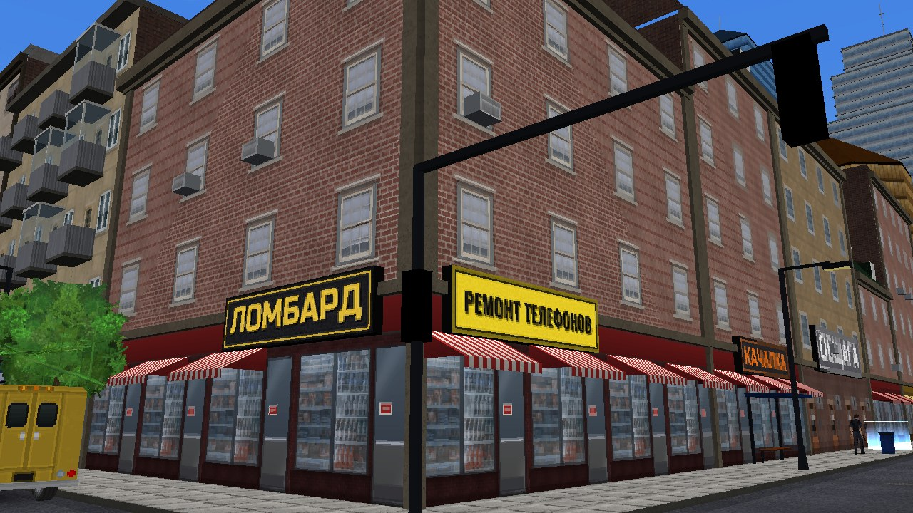
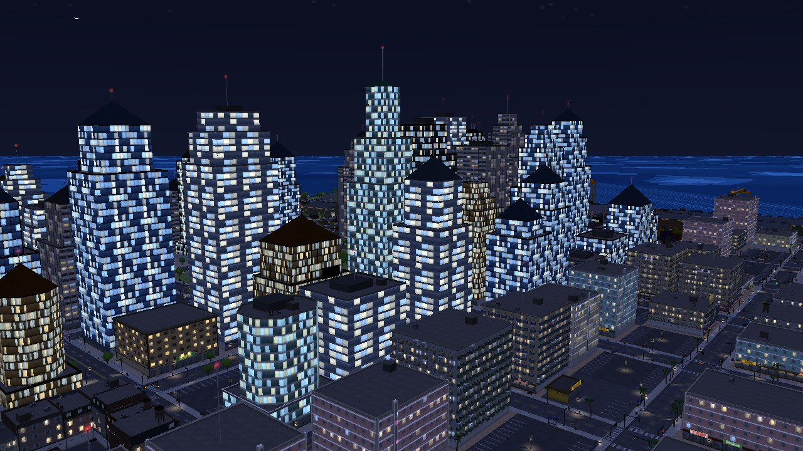
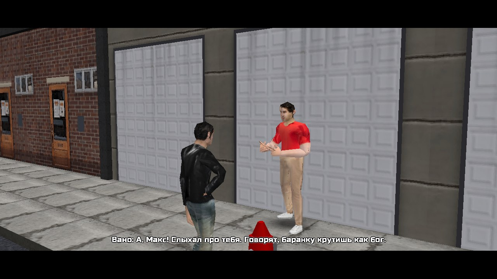
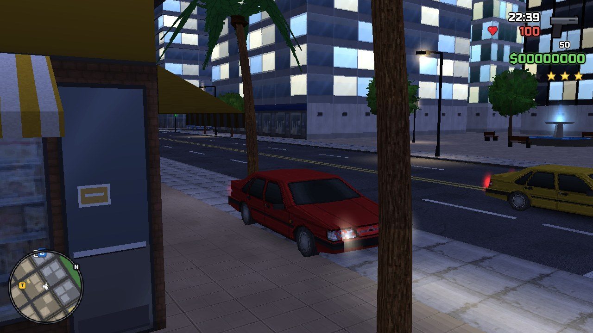

# Deadly District — «Гиблый район»

Криминальный боевик с открытым миром в духе **GTA III**: город, по которому можно ходить и ездить,
угон машин, перестрелки, полиция с шестью звёздами розыска и сюжет из 12 заданий.

Игра написана на **Python 3 + Panda3D** и собирается в обычное Windows-приложение (`DeadlyDistrict.exe`).

Графика — в стиле первой PlayStation и ранней PS2: люди и машины — готовые модели с фототекстурами,
дома обшиты материалами из фотографий, у них есть карнизы, балконы, козырьки, пожарные лестницы и
разные крыши. Чьи это модели и материалы и на каких условиях они взяты, расписано в разделе
[«Лицензии»](#лицензии).



| | |
|---|---|
|  |  |
|  |  |
|  |  |

> Снимки сделаны без видеокарты, программным рендером (`python tools/make_screenshots.py`). На видеокарте
> игра дополнительно включает сглаживание краёв и анизотропную фильтрацию, которых на этих снимках нет.

## Как запустить

### Готовая сборка для Windows

1. Скачайте архив [`release/DeadlyDistrict-win64.zip`](release/DeadlyDistrict-win64.zip).
2. Распакуйте его целиком в любую папку.
3. Запустите `DeadlyDistrict.exe`.

Нужна 64-разрядная Windows 10 или 11 и видеокарта с OpenGL (подойдёт любая встроенная). Устанавливать ничего не
требуется: Python и движок уже внутри. `exe` не работает отдельно от соседних файлов (`*.dll`, папка `assets`).

При первом запуске Windows может показать окно SmartScreen «Система Windows защитила ваш компьютер» — у сборки нет
цифровой подписи. Нажмите «Подробнее» → «Выполнить в любом случае».

**Экран.** Игра открывается во весь экран в родном разрешении монитора (окно без рамки, видеорежим не
меняется). В меню «Настройки → Графика и экран» можно выбрать окно или настоящий полноэкранный режим,
разрешение, вид текстур (чёткие «пиксельные» или сглаженные), сглаживание краёв и дальность прорисовки.
Если после смены режима экран повёл себя странно, удалите файл `settings.json` из папки настроек.

**Своя музыка.** Положите песни (mp3, ogg, wav, flac, m4a) в папку `music` рядом с `DeadlyDistrict.exe`.
В машине клавишей `R` выберите станцию «Астрахань FM» — она играет ваши файлы вперемешку, `N` включает
следующую песню. Чужую музыку игра с собой не несёт: у песен есть правообладатели.

Настройки, сохранения, снимки экрана и журнал запуска лежат в папке `%LOCALAPPDATA%\DeadlyDistrict`
(вставьте этот путь в адресную строку Проводника). Если игра не стартует, причина будет в файлах
`output.log` и `crash.log` из этой папки.

### Из исходников (Windows, Linux, macOS)

```
pip install -r requirements.txt
python main.py
```

### Сборка exe

```
pip install -r requirements.txt setuptools wheel
python setup.py build_apps
```

Готовое приложение появится в `build/win_amd64/`. Собирать можно на любой системе, в том числе на Linux:
нужные файлы для Windows скачиваются из PyPI.

## Управление

| Пешком | |
|---|---|
| `W` `A` `S` `D` | движение |
| Мышь | обзор и прицел |
| `Shift` | бег |
| `Пробел` | прыжок |
| ЛКМ | удар или выстрел |
| ПКМ | точный прицел |
| Колесо, `Q` / `E`, `1`–`9` | выбор оружия |
| `F` или `Enter` | сесть в машину (чужую — угнать) |

| За рулём | |
|---|---|
| `W` / `S` | газ, тормоз и задний ход |
| `A` / `D` | руль |
| `Пробел` | ручной тормоз |
| ЛКМ | стрельба из окна (пистолет, «Узи») |
| `H` | сигнал, в служебных машинах — сирена |
| `R` | радио: следующая станция |
| `N` | следующая песня |
| `B` | взгляд назад |
| `T` | подработка в такси (в такси) |
| `F` | выйти из машины |

| Общее | |
|---|---|
| `C` | дальность камеры |
| `Esc` или `P` | пауза, карта, статистика, настройки |
| `F12` | снимок экрана |

Буквенные клавиши работают при любой раскладке клавиатуры.

## Что есть в игре

- **Город Порт-Глухов**: семь районов — Ржавый квартал, Сосновка, Порт, Старый город, Деловой центр,
  Центральный парк и Набережная; 333 здания, пляж с пирсом, доки, светофоры, смена дня и ночи, дождь и туман.
  Дома не коробки: кирпичные кварталы с лепниной, мансардами и пожарными лестницами, панельки с балконами,
  гостиницы в духе ар-деко, башни со шпилями, пирамидами и уступами.
- **Люди со скелетной анимацией**: 24 облика горожан, полицейских, спецназа, медиков и бандитов; они ходят,
  бегают, дерутся, целятся и падают; кто где живёт, зависит от района.
- **17 видов транспорта** — от «Крохи» и такси до автобуса, фургона и армейского грузовика. Машины
  красятся в 14 цветов, горят и взрываются; трафик соблюдает светофоры и объезжает пробки.
- **Радио**: четыре станции с музыкой игры и «Астрахань FM», которая играет ваши собственные песни.
- **9 видов оружия**: кулаки, бита, пистолет, «Узи», дробовик, автомат, гранатомёт, гранаты, коктейль Молотова.
- **Розыск от 1 до 6 звёзд**: патрули, с четвёртой звезды спецназ, с пятой агенты, на шестой армия.
  Избавиться от погони можно, скрывшись из виду, подобрав значок-взятку или перекрасив машину ($300).
- **12 сюжетных заданий** у трёх заказчиков — Вано (гараж), Розы (бар) и Профа (высотка).
  Буквы `В`, `Р`, `П` на радаре показывают, где ждёт работа.
- **Побочные занятия**: подработка таксистом, 33 тайника, оружейные магазины.
- **Сохранение** — синий маркер у общаги, где живёт Макс (плюс автосохранение после каждого задания).
  Там же восстанавливается здоровье; бронежилет продаётся в оружейном магазине.
  После гибели герой приходит в себя у больницы, после ареста — у участка, уже без оружия.

## Устройство проекта

```
main.py              точка входа (python main.py --selftest — самопроверка без окна)
setup.py             сборка приложения
game/                код игры
  city.py            процедурный город (кварталы, здания, дороги)
  citymesh.py        геометрия города, props.py — уличные объекты
  facade.py          объёмные здания: карнизы, балконы, козырьки, крыши, башни
  roadnet.py         полосы движения, светофоры, тротуары
  vehicle.py         машины и физика, traffic.py — трафик
  ped.py             персонажи, crowd.py — прохожие
  models.py          готовые модели: какая кому, как красить машины
  pedvisual.py       скелетная анимация персонажа, оружие в руке
  player.py          игрок и камера, weapons.py — оружие
  police.py          розыск и погони
  missions.py        сюжет, такси, сохранения
  audio.py           звук и радио
  hud.py, menu.py    интерфейс, app.py — главный цикл, окно и настройки
assets/              текстуры, звуки, музыка, шрифты
assets/models/       модели: персонажи, клипы анимации, машины, оружие (.bam и текстуры)
tools/               генераторы ассетов, импорт моделей, сборка релиза
tests/               автотесты
release/             готовая сборка для Windows
```

Что чем создаётся:

| Команда | Что делает |
|---|---|
| `python tools/gen_city.py` | текстуры города из фотоматериалов Classic64: фасады, первые этажи, дороги, земля, листва |
| `python tools/gen_textures.py` | остальные текстуры: вывески, рекламные щиты, значки, эффекты, вода |
| `python tools/gen_sounds.py` | звуки и музыка радиостанций |
| `python tools/gen_map.py` | карта для меню паузы |
| `python tools/import_psx.py all` | персонажи, анимация, машины (и автобус через `gen_bus.py`) |
| `python tools/import_models.py weapons` | оружие |
| `python tools/make_screenshots.py` | снимки для этого файла |
| `python tools/make_release.py` | сборка и архив для Windows |

Генераторам нужны `pillow`, `numpy`, `scipy`, `soundfile`; импорту моделей — ещё `panda3d-gltf` и Node.js
(какие пакеты поставить, написано в начале `tools/import_psx.py`). Исходники моделей и материалов в
репозиторий не входят: `python tools/import_psx.py fetch` и `python tools/gen_city.py fetch` скачивают их
с GitHub в папку `.cache/`. Игре всё это не нужно — она читает готовые файлы из `assets`.

## Как заменить модели

Игра берёт модели из `assets/models`, а что из них кому достаётся, описано таблицами в `game/models.py`
(машины, персонажи, оружие) и `game/pedvisual.py` (какой клип анимации играть при ходьбе, беге, ударе,
прицеливании, падении). Механика от моделей не зависит: габариты, скорость и столкновения машин заданы в
`game/vehicle.py`, а модель подгоняется под них по размеру.

- **Машина**: импорт рассчитан на набор GGBot — OBJ и текстура в нескольких вариантах окраски.
  `tools/import_psx.py` отделяет колёса и по различиям между вариантами находит окрашенные места кузова,
  чтобы машину можно было перекрашивать; где стоят фары и фонари, для каждой модели записано в таблице
  `CAR_LIGHTS`. Под модель из другого набора эти места придётся подправить.
- **Персонаж**: модель на том же скелете, что у остальных (66 костей, Mesh2Motion), иначе к ней не подойдут
  клипы анимации; текстура — один PNG.
- **Здания**: внешний вид задаётся текстурой фасада (`fac_*`) и первого этажа (`gf_*`), а объёмные детали
  под неё подбирает `game/facade.py`.

Модели должны иметь лицензию, разрешающую распространение: вырезанные из чужих игр сюда класть нельзя.

## Тесты

```
pip install pytest
python -m pytest tests            # логика, все 12 заданий, такси, магазины, сохранение, модели и анимация
python tests/soak.py 600 1        # стресс-тест: 10 игровых минут случайных действий
```

Тесты запускают игру целиком без окна, на программном рендере, поэтому работают и без видеокарты.

Собранное приложение проверяется отдельно — так ловятся файлы, не попавшие в сборку:

```
DD_PLATFORMS=manylinux2014_x86_64 DD_SELFTEST=1 python setup.py build_apps --build-base /tmp/ddbuild
/tmp/ddbuild/manylinux2014_x86_64/DeadlyDistrict-selftest --selftest; echo $?     # 0 — всё на месте
```

Итог самопроверки (`SELFTEST OK` или чего не хватает) пишется в `output.log` в папке настроек игры.

## Лицензии

| Что | Автор | Условия |
|---|---|---|
| Люди (модели и текстуры) | Elbolilloduro, набор «Characters PSX» | см. примечание ниже |
| Скелет и анимация людей | проект Mesh2Motion | CC0 |
| Машины (10 моделей) | GGBot, набор «PSX Style Cars» | CC0 |
| Материалы города: стены, окна, двери, дороги, земля, листва | Craig Snedeker, Classic64 Asset Library | CC0 |
| Оружие | Quaternius | CC0 |
| Здания, автобус, вывески, значки, звуки, музыка | созданы кодом этого проекта | — |
| Шрифты Russo One, Dela Gothic One, Oswald | их авторы | SIL Open Font License (тексты — в `assets/fonts`) |
| Движок Panda3D | | BSD |

Подробности и адреса источников — в [`assets/models/CREDITS.md`](assets/models/CREDITS.md).

**О персонажах.** Модели взяты из открытого репозитория Mesh2Motion, где они опубликованы как CC0. Сам автор
на странице набора пишет иначе: пользоваться можно бесплатно в любых проектах и без указания авторства, но
перевыкладывать набор (в том числе изменённый) нельзя. В игре модели лежат в собранном виде как её часть,
а не как набор для скачивания; автор назван. Если вы делаете на основе этого проекта что-то своё, исходный
набор берите у автора: <https://elbolilloduro.itch.io/characters-psx>.

Музыки с правообладателями в проекте нет: радиостанции играют мелодии, созданные кодом, а свои песни
игрок добавляет сам.

Игра — самостоятельное произведение по мотивам жанра; она не использует материалы Rockstar Games и никак
с этой компанией не связана.
