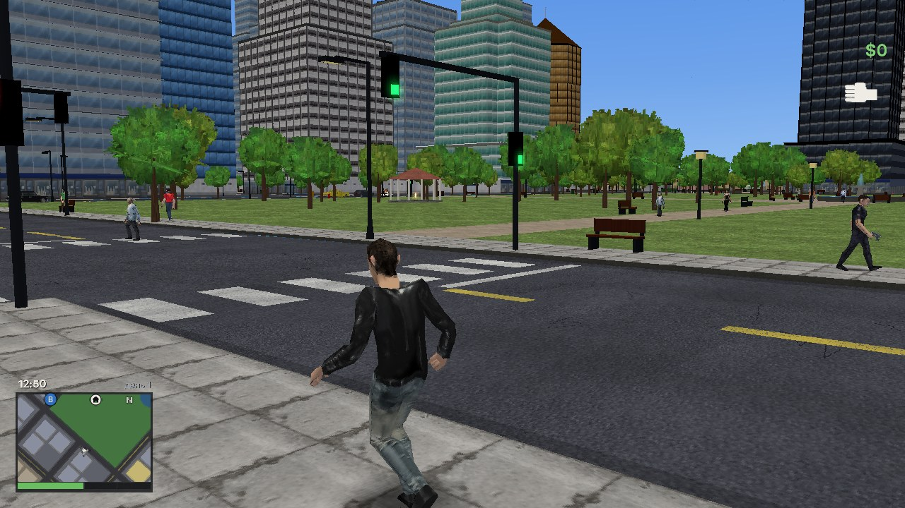
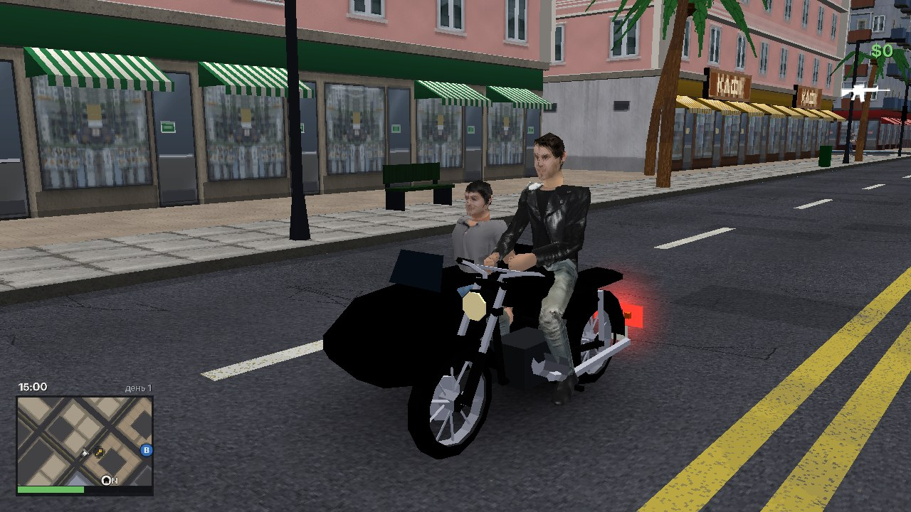
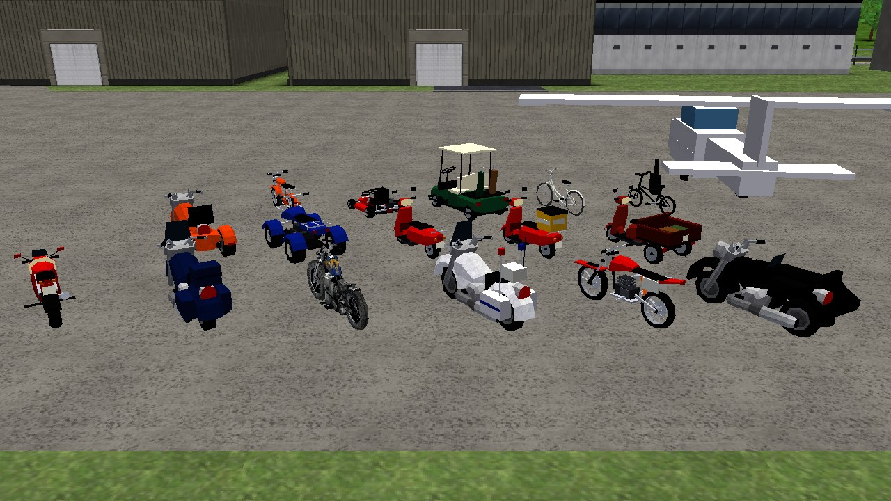
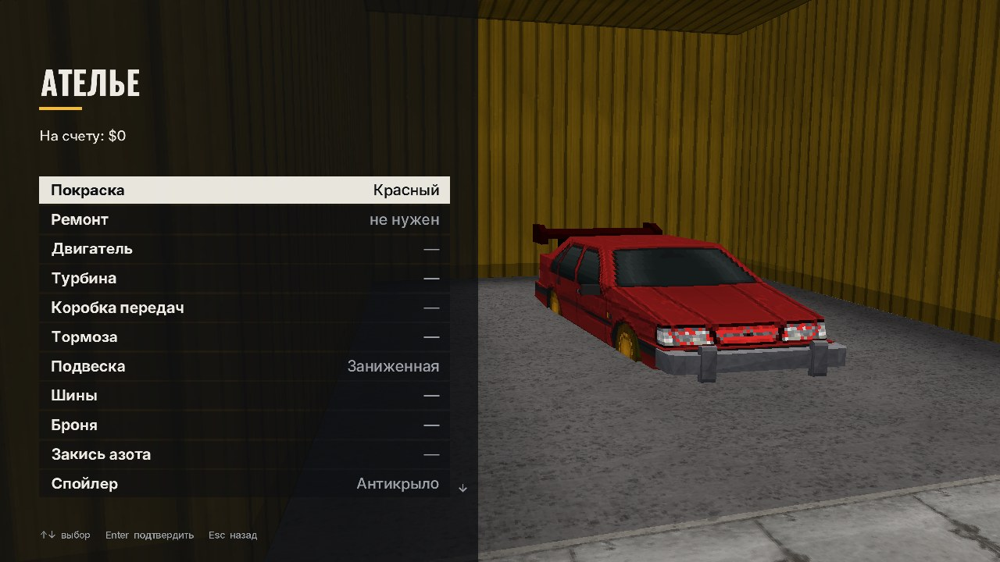
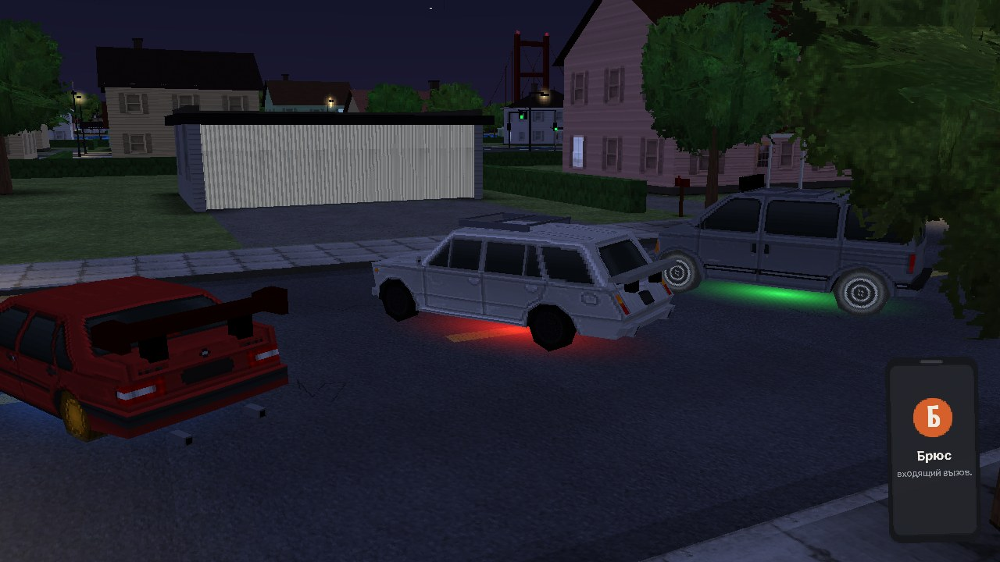
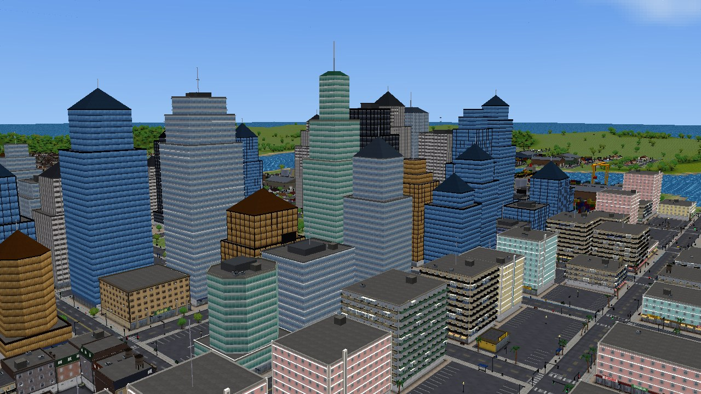
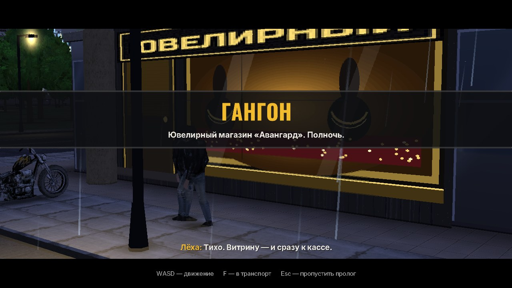
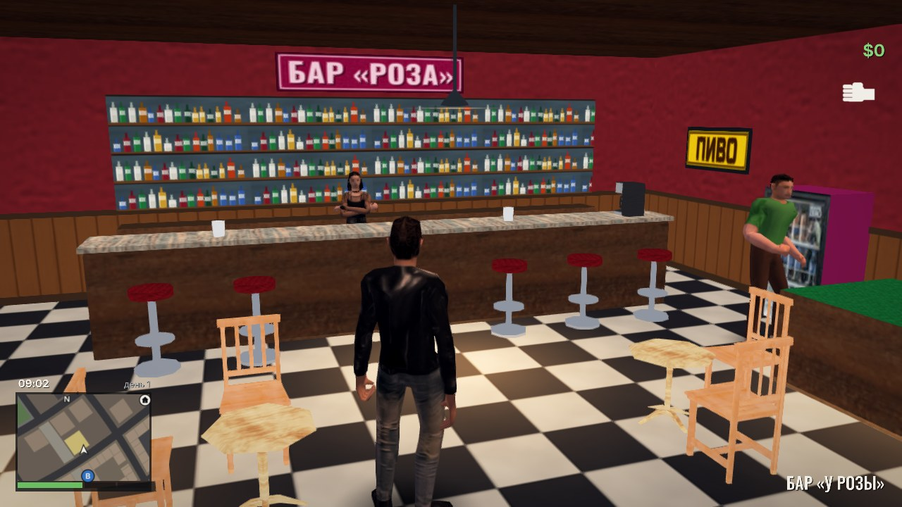
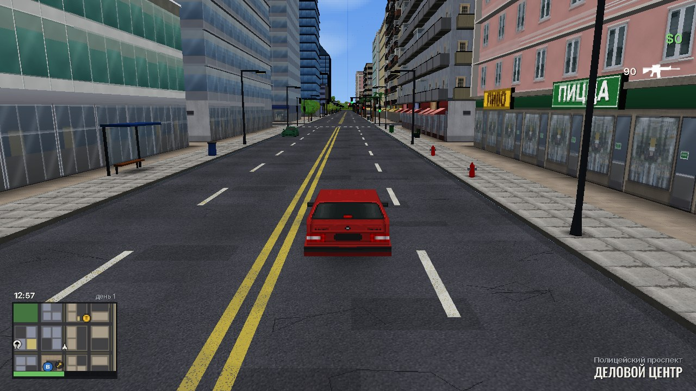

# Deadly District — «Гиблый район»

Криминальный боевик с открытым миром в духе **GTA III**: город на острове и два берега за мостами,
по которым можно ходить и ездить, угон машин и мотоциклов, перестрелки, полиция с шестью звёздами розыска,
помещения, в которые можно войти, свой гараж, тюнинг и сюжет о двух братьях, который начинается с телефонного
звонка.

Игра написана на **Python 3 + Panda3D** и собирается в обычное Windows-приложение (`DeadlyDistrict.exe`).

Графика — в стиле первой PlayStation и ранней PS2: люди, машины и оружие — готовые модели с фототекстурами,
дома обшиты материалами из фотографий, у них есть карнизы, балконы, козырьки, пожарные лестницы и
разные крыши. Мотоциклы, скутеры, велосипеды и прочая мелкая техника собраны кодом проекта: готового
набора в том же стиле и с понятной лицензией найти не удалось. Чьи модели и материалы взяты и на каких
условиях, расписано в разделе [«Лицензии»](#лицензии).


| | |
|---|---|
|  |  |
|  |  |
|  |  |
|  |  |
|  |  |
|  |  |
|  |  |
|  |  |
|  |  |
|  |  |
|  |  |
|  | |

> Снимки сделаны без видеокарты, программным рендером (`python tools/make_screenshots.py`). На видеокарте
> игра дополнительно включает сглаживание краёв и анизотропную фильтрацию, которых на этих снимках нет.

## Как запустить

### Готовая сборка для Windows

1. Скачайте архив [`release/DeadlyDistrict-win64.zip`](release/DeadlyDistrict-win64.zip).
2. Распакуйте его целиком в любую папку.
3. Запустите `DeadlyDistrict.exe`.

Нужна 64-разрядная Windows 10 или 11 и видеокарта с OpenGL (подойдёт любая встроенная). Устанавливать ничего не
требуется: Python и движок уже внутри. `exe` не работает отдельно от соседних файлов (`*.dll`, папка `assets`).

При первом запуске Windows может показать окно SmartScreen «Система Windows защитила ваш компьютер» — у сборки нет
цифровой подписи. Нажмите «Подробнее» → «Выполнить в любом случае».

**Экран.** Игра открывается во весь экран в родном разрешении монитора (окно без рамки, видеорежим не
меняется). В меню «Настройки → Графика и экран» можно выбрать окно или настоящий полноэкранный режим,
разрешение, вид текстур (чёткие «пиксельные» или сглаженные), сглаживание краёв и дальность прорисовки.
Если после смены режима экран повёл себя странно, удалите файл `settings.json` из папки настроек.

**Своя музыка.** Положите песни (mp3, ogg, wav, flac, m4a) в папку `music` рядом с `DeadlyDistrict.exe`.
В машине клавишей `R` выберите станцию «Астрахань FM» — она играет ваши файлы вперемешку, `N` включает
следующую песню. Чужую музыку игра с собой не несёт: у песен есть правообладатели.

Настройки, сохранения, снимки экрана и журнал запуска лежат в папке `%LOCALAPPDATA%\DeadlyDistrict`
(вставьте этот путь в адресную строку Проводника). Если игра не стартует, причина будет в файлах
`output.log` и `crash.log` из этой папки.

### Из исходников (Windows, Linux, macOS)

```
pip install -r requirements.txt
python main.py
```

### Сборка exe

```
pip install -r requirements.txt setuptools wheel
python setup.py build_apps
```

Готовое приложение появится в `build/win_amd64/`. Собирать можно на любой системе, в том числе на Linux:
нужные файлы для Windows скачиваются из PyPI.

## Управление

| Пешком | |
|---|---|
| `W` `A` `S` `D` | движение |
| Мышь | обзор и прицел |
| `Shift` | бег |
| `Пробел` | прыжок |
| ЛКМ | удар или выстрел |
| ПКМ | точный прицел |
| Колесо, `Q` / `E`, `1`–`9` | выбор оружия |
| `F` или `Enter` | сесть в машину (чужую — угнать) |

| За рулём | |
|---|---|
| `W` / `S` | газ, тормоз и задний ход |
| `A` / `D` | руль |
| `Пробел` | ручной тормоз |
| `Shift` | закись азота, если она стоит на машине |
| ЛКМ | стрельба на ходу (пистолет, пистолет с глушителем, «Узи») |
| `H` | сигнал, в служебных машинах и на патрульном мотоцикле — сирена |
| `R` | радио: следующая станция |
| `N` | следующая песня |
| `B` | взгляд назад |
| `T` | подработка в такси (в такси) |
| `F` | выйти из машины |

| Общее | |
|---|---|
| `Enter` | следующая реплика в разговоре |
| `C` | дальность камеры |
| `Esc` или `P` | пауза, карта, статистика, настройки |
| `F12` | снимок экрана |

Буквенные клавиши работают при любой раскладке клавиатуры.

## Что есть в игре

- **Порт-Глухов и окрестности**: остров с городом и два берега материка — всего 12 районов и 640 зданий.
  На острове Ржавый квартал, Сосновка, Порт, Старый город, Деловой центр, Центральный парк и Набережная;
  за Большим мостом на северном берегу — Заречье и Слобода, за Портовым мостом на восточном — Нефтегавань,
  посёлок Маячный и Аэродром. Берега соединяет загородное шоссе, так что остров можно объехать кругом.
  У мира есть рельеф: холмы, неровная береговая линия, пляжи; есть доки, пирсы, светофоры, смена дня и ночи,
  дождь и туман. В порту у причала стоит сухогруз «Арктур»: на палубу поднимаются по трапу, машину с неё
  спускают по аппарели.
- **Сюжет** идёт по сценарию из двух глав. Пролог: ночной автобус привозит Макса на конечную. Там ему звонит
  брат, Брюс, — и дальше дела приходят по телефону.
  - «Брат за брата» ($5000): добраться до дома (Сосновая, 12), взять пистолет, отбить Брюса у бандитов на
    первом причале и отвезти его домой. Брюс идёт за Максом сам и садится к нему в машину.
  - «Жёлтый контейнер» ($10 000): разговор с боссом в казино (Банковская, 21), пистолет с глушителем, охрана на
    сухогрузе — у охранников есть поле зрения, на громкий выстрел сбегаются все, — жёлтый контейнер и спорткар,
    который нужно довезти боссу, не разбив: за состоянием машины следит полоска на экране.
- **Подработка** открывается после сюжета: 18 заданий у пяти заказчиков — Вано (гараж), Роза (бар), Захар
  (лодочный сарай в Нефтегавани), Гром (чайная в Заречье) и Проф (башня в Деловом центре). Буквы `В`, `Р`, `З`,
  `Г`, `П` на радаре и на карте показывают, где ждёт работа. Ещё есть подработка таксистом и 47 тайников на
  всех трёх берегах.
- **43 вида транспорта.**
  - 27 машин: от «Крохи» и такси до лимузина, маршрутки, пожарной, инкассаторского фургона, автобуса и
    армейского грузовика. Десять машин, добавленных в этой версии, — переделки прежних кузовов: другие
    пропорции, окраска, надстройки, характер на дороге.
  - 16 видов мотоциклов и их родни: спортбайк «Стрела», чоппер «Ворон», туристический «Странник», кроссовый
    «Кузнечик», патрульный мотоцикл с сиреной, «Тайга» с коляской, трайк «Мамонт», квадроцикл, скутеры «Оса» и
    «Курьер», грузовой мотороллер «Муравей», мопед «Стриж», карт, гольф-кар, велосипед и BMX. Ездок сидит
    верхом и держится за руль; на «Вороне», «Страннике», «Мамонте», в коляске «Тайги» и в гольф-каре есть место
    для пассажира. Двухколёсные ложатся в поворот, сильный удар выбивает из седла. Ездок ничем не прикрыт:
    пуля, попавшая выше руля, ранит его самого, а чужого мотоциклиста выстрел, бита или таран сбрасывают
    на асфальт. Велосипед не взрывается, а ломается.
  - Машины красятся в 14 цветов, горят и взрываются; трафик соблюдает светофоры и объезжает пробки.
- **Тюнинг**: 41 деталь в 16 разделах. В покрасочной — она же ателье — ставят двигатель, турбину, коробку,
  тормоза, подвеску, шины, броню и закись азота (всё это меняет поведение машины), а ещё спойлеры, диски,
  неон, фары, сигнал, выхлоп, багажник на крышу и кенгурятник. Изменения видны сразу, прямо в боксе.
  Служебные машины и автобус в ателье не берут.
- **Гараж** у дома Макса на три машины: загоните машину внутрь и выйдите — она останется за вами и попадёт
  в сохранение вместе с цветом, состоянием и тюнингом. Ворота открываются сами.
- **14 видов оружия**: кулаки, нож, бита, пистолет, пистолет с глушителем, пистолет-пулемёт, дробовик,
  двустволка, автомат, карабин М4, снайперская винтовка с оптикой, гранатомёт, гранаты, коктейль Молотова.
  Длинное оружие держат двумя руками, пистолет опущен, пока герой не целится. Выстрел с глушителем
  не поднимает тревогу.
- **Розыск от 1 до 6 звёзд**: патрули на машинах и мотоциклах, с четвёртой звезды спецназ, с пятой агенты,
  на шестой армия. Избавиться от погони можно, скрывшись из виду, подобрав значок-взятку или перекрасив
  машину ($300).
- **Помещения**: 12 комнат, куда можно войти с улицы, — комната Макса, кабинет босса в казино, гараж Вано,
  бар «У Розы», кабинет Профа, два оружейных магазина, полицейский участок, больница, банк, лодочный сарай
  Захара и чайная в Заречье. Вход — жёлтая стрелка у двери: в неё нужно войти пешком. Внутри стоит мебель,
  сидят и стоят хозяева и посетители; в больнице лечат за $100, в оружейном торгуют с прилавка.
- **Люди со скелетной анимацией**: 41 облик горожан, полицейских, спецназа, медиков и бандитов; они ходят,
  бегают, дерутся, целятся, сидят, разговаривают и падают; кто где живёт, зависит от района.
- **Интерфейс**: радар с полосками здоровья и брони слева внизу, деньги, звёзды и оружие справа вверху,
  телефон во время звонка, меню на плашках. Шрифты — Inter и Oswald.
- **Радио**: четыре станции с музыкой игры и «Астрахань FM», которая играет ваши собственные песни.
- **Сохранение** — синий маркер у кровати в комнате Макса (плюс автосохранение после каждого задания и
  при перемене в гараже). Там же восстанавливается здоровье; бронежилет продаётся в оружейном магазине.
  После гибели герой приходит в себя у больницы, после ареста — у участка, уже без оружия.

### Чего в игре нет

- Улицы идут по сетке — изгибаются только берега, холмы и загородное шоссе.
- У каждой точки мира одна высота: по мостам ездят, но под ними нельзя ни проехать, ни проплыть.
- Помещения — отдельные комнаты: при входе и выходе экран на мгновение темнеет, улица в это время
  стоит на паузе. Оружие в помещениях убрано; с розыском и во время задания в двери не пускают.
- Озвучки нет: все реплики — субтитрами.
- Сюжет короткий — две главы; остальное время занимают подработка, тайники и свободная игра.
- Мотоциклы собраны кодом из простых форм: они проще машин, у которых модели готовые.
- В машине седоков не видно; видно только тех, кто едет верхом, в коляске или в гольф-каре.

## Устройство проекта

```
main.py              точка входа (python main.py --selftest — самопроверка без окна)
setup.py             сборка приложения
game/                код игры
  city.py            процедурный мир: остров, берега, кварталы, здания, дороги, мосты
  terrain.py         рельеф и берега (готовые данные — в assets/terrain)
  citymesh.py        геометрия города, props.py — уличные объекты
  interiors.py       помещения: комнаты, мебель, жильцы, вход и выход
  facade.py          объёмные здания: карнизы, балконы, козырьки, крыши, башни
  roadnet.py         полосы движения, светофоры, тротуары
  vehicle.py         машины и физика, traffic.py — трафик
  bikes.py           мотоциклы, скутеры, велосипеды, карт, гольф-кар: модели из кода и посадка ездока
  tuning.py          детали тюнинга и их действие, garage.py — гараж у дома
  ped.py             персонажи, crowd.py — прохожие
  models.py          готовые модели: какая кому, как красить машины
  pedvisual.py       скелетная анимация персонажа, оружие в руке
  player.py          игрок и камера, weapons.py — оружие
  police.py          розыск и погони
  missions.py        задания, пролог, такси, сохранения
  story.py           сюжет: звонки, спутник, сцена у босса, охрана на корабле
  audio.py           звук и радио
  ui.py, hud.py, menu.py   интерфейс, app.py — главный цикл, окно и настройки
assets/              текстуры, звуки, музыка, шрифты
assets/models/       модели: персонажи, клипы анимации, машины, оружие, мебель (.bam и текстуры)
tools/               генераторы ассетов, импорт моделей, сборка релиза
tests/               автотесты
release/             готовая сборка для Windows
```

Что чем создаётся:

| Команда | Что делает |
|---|---|
| `python tools/gen_terrain.py` | рельеф и берега (`assets/terrain`); запускать после правки таблиц города в `game/city.py` |
| `python tools/gen_city.py` | текстуры города из фотоматериалов Classic64: фасады, первые этажи, дороги, земля, листва |
| `python tools/gen_interior.py` | текстуры комнат: полы, стены, полки, плакаты |
| `python tools/gen_textures.py` | остальные текстуры: вывески, рекламные щиты, значки, эффекты, вода |
| `python tools/gen_sounds.py` | звуки и музыка радиостанций |
| `python tools/gen_map.py` | карта для меню паузы |
| `python tools/import_psx.py all` | персонажи, анимация, машины (и автобус через `gen_bus.py`) |
| `python tools/import_weapons.py all` | оружие в стиле PS1 (бита, гранаты и бутылка — `import_models.py weapons`) |
| `python tools/gen_ui.py` | значки интерфейса: радар, оружие, телефон, прицел |
| `python tools/import_furniture.py all` | мебель и техника для комнат |
| `python tools/make_screenshots.py` | снимки для этого файла |
| `python tools/make_release.py` | сборка и архив для Windows |

Генераторам нужны `pillow`, `numpy`, `scipy`, `soundfile`; импорту моделей — ещё `panda3d-gltf` и Node.js
(какие пакеты поставить, написано в начале `tools/import_psx.py`). Исходники моделей и материалов в
репозиторий не входят: `python tools/import_psx.py fetch`, `python tools/gen_city.py fetch` и
`python tools/import_furniture.py fetch` скачивают их с GitHub в папку `.cache/`. Игре всё это не нужно —
она читает готовые файлы из `assets`.

## Как заменить модели

Игра берёт модели из `assets/models`, а что из них кому достаётся, описано таблицами в `game/models.py`
(машины, персонажи, оружие) и `game/pedvisual.py` (какой клип анимации играть при ходьбе, беге, ударе,
прицеливании, падении). Механика от моделей не зависит: габариты, скорость и столкновения машин заданы в
`game/vehicle.py`, а модель подгоняется под них по размеру.

- **Машина**: импорт рассчитан на набор GGBot — OBJ и текстура в нескольких вариантах окраски.
  `tools/import_psx.py` отделяет колёса и по различиям между вариантами находит окрашенные места кузова,
  чтобы машину можно было перекрашивать; где стоят фары и фонари, для каждой модели записано в таблице
  `CAR_LIGHTS`. Под модель из другого набора эти места придётся подправить.
- **Персонаж**: модель на том же скелете, что у остальных (66 костей, Mesh2Motion), иначе к ней не подойдут
  клипы анимации; текстура — один PNG. Из 13 исходных моделей импорт делает 41 облик: собирает новых людей
  из тела одной модели и головы другой и перекрашивает одежду (таблицы `COMBOS`, `RECOLORS`, `VARIANTS`
  в `tools/import_psx.py`).
- **Мотоцикл**: готовой модели нет — его собирает `game/bikes.py` из труб, колёс и обтекаемых деталей вокруг
  позы ездока (таблицы `POSES` и `KINDS`): руль оказывается там, где у сидящего человека кисти, подножки —
  под стопами. Новый вид — это строка в `KINDS`, функция-сборщик и запись `Spec` в `game/vehicle.py`.
- **Оружие**: таблица `WEAPONS` в `tools/import_weapons.py` — откуда взять модель, какой она длины и где у неё
  рукоять и дуло; по ним оружие ложится в руку.
- **Мебель**: список предметов — в `tools/import_furniture.py`, расстановка по комнатам — в `game/interiors.py`.
- **Здания**: внешний вид задаётся текстурой фасада (`fac_*`) и первого этажа (`gf_*`), а объёмные детали
  под неё подбирает `game/facade.py`.

Модели должны иметь лицензию, разрешающую распространение: вырезанные из чужих игр сюда класть нельзя.

## Тесты

```
pip install pytest
python -m pytest tests            # логика, сюжет и все 18 заданий, пролог, транспорт, тюнинг, гараж, сохранение
python tests/soak.py 600 1        # стресс-тест: 10 игровых минут случайных действий
```

Тесты запускают игру целиком без окна, на программном рендере, поэтому работают и без видеокарты.

Собранное приложение проверяется отдельно — так ловятся файлы, не попавшие в сборку:

```
DD_PLATFORMS=manylinux2014_x86_64 DD_SELFTEST=1 python setup.py build_apps --build-base /tmp/ddbuild
/tmp/ddbuild/manylinux2014_x86_64/DeadlyDistrict-selftest --selftest; echo $?     # 0 — всё на месте
```

Итог самопроверки (`SELFTEST OK` или чего не хватает) пишется в `output.log` в папке настроек игры.

## Лицензии

| Что | Автор | Условия |
|---|---|---|
| Люди (модели и текстуры) | Elbolilloduro, набор «Characters PSX» | см. примечание ниже |
| Мебель и техника в комнатах | Elbolilloduro, набор «Pack of low poly psx style models» | см. примечание ниже |
| Скелет и анимация людей | проект Mesh2Motion | CC0 |
| Машины (10 моделей, из них сделаны 27 машин игры) | GGBot, набор «PSX Style Cars» | CC0 |
| Мотоциклы, скутеры, велосипеды, квадроцикл, карт, гольф-кар (16 видов) | созданы кодом этого проекта | — |
| Материалы города и комнат: стены, окна, двери, полы, дороги, земля, листва | Craig Snedeker, Classic64 Asset Library | CC0 |
| Оружие: 11 моделей в стиле PS1 | Mextie, Ace Spectre, Cemckrc и другие — из сборника `M3-org/retro3d-assets` | см. примечание ниже |
| Бита, граната, бутылка | Quaternius | CC0 |
| Город и берега, здания, комнаты, сухогруз, автобус, вывески, значки, звуки, музыка | созданы кодом этого проекта | — |
| Шрифты Inter, Oswald, Caveat, Russo One, Dela Gothic One | их авторы | SIL Open Font License (тексты — в `assets/fonts`) |
| Движок Panda3D | | BSD |

Подробности и адреса источников — в [`assets/models/CREDITS.md`](assets/models/CREDITS.md).

**О персонажах.** Модели взяты из открытого репозитория Mesh2Motion, где они опубликованы как CC0. Сам автор
на странице набора пишет иначе: пользоваться можно бесплатно в любых проектах и без указания авторства, но
перевыкладывать набор (в том числе изменённый) нельзя. В игре модели лежат в собранном виде как её часть,
а не как набор для скачивания; автор назван. Если вы делаете на основе этого проекта что-то своё, исходный
набор берите у автора: <https://elbolilloduro.itch.io/characters-psx>.

**О мебели.** Набор того же автора взят из открытого сборника `M3-org/retro3d-assets`, где сказано, что его
модели можно использовать в том числе в коммерческих проектах и без указания авторства. Условия на странице
самого автора мы не сверяли (страница была недоступна), поэтому поступаем как с персонажами: модели лежат
в собранном виде как часть игры, автор назван.

**Об оружии.** Модели взяты из того же сборника `M3-org/retro3d-assets`. О сборнике сказано, что всё в нём
можно использовать в коммерческих проектах без указания авторства; условия на страницах самих авторов мы
не сверяли — эти страницы были недоступны. Какая модель чья, расписано в
[`assets/models/CREDITS.md`](assets/models/CREDITS.md); у двух наборов автор назван предположительно.

Музыки с правообладателями в проекте нет: радиостанции играют мелодии, созданные кодом, а свои песни
игрок добавляет сам.

Игра — самостоятельное произведение по мотивам жанра; она не использует материалы Rockstar Games и никак
с этой компанией не связана.
